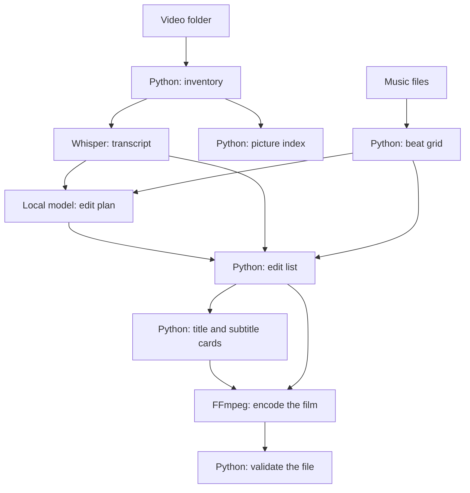

# Local travel-vlog editor

A local pipeline that turns a folder of video clips into a YouTube-ready film: inventory, speech-to-text, an edit decision list, licensed music, burned-in subtitles, and a validated H.264 file. The clips can come from any camera or phone. GoPro chapter files are grouped with their proxy and thumbnail. Every other MP4, MOV, M4V, or MKV is its own clip.

Speech recognition and the cut both run on this machine. Whisper transcribes the clips. A second open-weight model reads those transcripts and writes `editorial/edit_plan.json`. The render then follows that file. Neither step uses a paid API. The first run downloads the two model files; after that they stay on disk.

Footage, transcripts, the edit plan, and the finished video stay out of git. See [OPEN_SOURCE.md](OPEN_SOURCE.md) for how to run an episode and what the license requires for the music.

## Architecture

Whisper and the plan model are the only AI steps. Python decides and checks. FFmpeg reads and encodes the media.



```bash
python3 -m venv .venv
.venv/bin/pip install -r requirements.txt
cp config.example.toml config.toml
```
